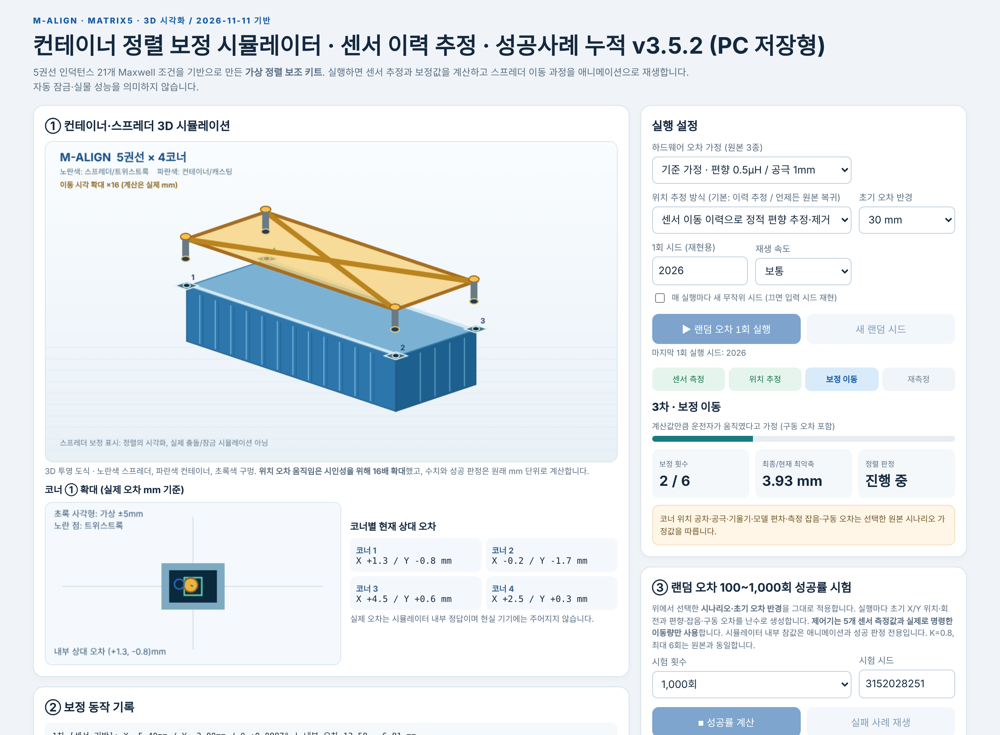

# MAS-kit 컨테이너 정렬 시뮬레이터

자기장(코일 인덕턴스)으로 컨테이너 코너캐스팅 구멍을 찾아 트위스트록과 맞추는 비광학 정렬 센서 **MAS-kit**의 시뮬레이터입니다.
스프레더 네 모서리에 코일 5개씩 달고, Ansys Maxwell로 계산한 센서 응답으로 "측정 → 위치 추정 → 이동"을 반복해 네 모서리를 맞춥니다.

> 2026 국립창원대학교 물류 신사업 아이디어 경진대회 출품작.
> 모든 성공률은 FEM 기반 가상 시뮬레이션이며 실제 장비 성능이 아닙니다.

## 바로 보기

| 방법 | 준비물 | 내용 |
|---|---|---|
| [`browser_demo/MAS-kit_브라우저_v3_6.html`](https://raw.githack.com/enterryena/MAS-kit-3D-AI/main/browser_demo/MAS-kit_%EB%B8%8C%EB%9D%BC%EC%9A%B0%EC%A0%80_v3_6.html) (링크로 바로 열림) | 웹 브라우저만 (휴대폰 가능) | 정식판 v3.6과 같은 화면·계산. 메인 서버·키트도 브라우저 안에서 가상으로 실행, 기록은 이 브라우저에만 저장 |
| `app/RUN_WITH_PYTHON.cmd` | Windows + Python 3.10 이상 | 정식판(v3.6.0). 기록이 PC에 영구 저장, 메인 서버 연동 |
| `app/BUILD_EXE.cmd` → `dist\MASKIT_Desktop.exe` | Windows + Python 3.10 이상 (빌드할 때만) | 정식판 EXE |

단계별 설명, 관리 창 버튼, 발표 수치 재현 방법, 문제 해결은 **[`docs/실행방법.md`](docs/실행방법.md)** 에 있습니다.

정식판 `app/MASKIT_Desktop.html`은 직접 열면 계산이 막혀 있습니다(저장소 연결용). 브라우저로 보려면 `browser_demo`를 쓰세요.
두 판의 계산 결과는 같습니다(기준 가정·시드 2026·1,000회에서 기존 격자 68회, 이력 추정 586회 성공으로 일치).

## 시뮬레이터가 보여주는 것

1. 3D 화면: 컨테이너와 스프레더, 네 모서리의 어긋남이 보정되는 과정
2. 1회 실행: 매 단계 센서값, 추정 이동량, 실제 오차 변화 기록
3. 100~1,000회 성공률: 무작위 초기 오차에서 네 모서리가 모두 ±5 mm 안에 드는 비율과 95% 신뢰구간
4. 누적 보관함: 실행한 성공·실패 사례 기록 (제어기 학습에는 쓰지 않음)
5. 메인 서버 연동(v3.6): 보조 키트(4대 1세트)는 메인 서버 지시로 센싱하고 결과(장치당 23항목)를 보냄. 규칙 기반 메인 서버가 리치스태커 기존 센서와 키트를 우선순위로 비교해 보정·하강을 지시하는 가상 현장 포함 → [`docs/전송_프로토콜.md`](docs/전송_프로토콜.md), [`docs/3단계_메인서버_가상현장.md`](docs/3단계_메인서버_가상현장.md)
6. **3D AI 정렬 시뮬레이터**: AI(Ollama, 무료)가 키트와 리치스태커를 지휘하는 과정을 3D로 확인. 위험한 지시는 규칙 안전장치가 막음 → [`docs/3D_AI_시뮬레이터.md`](docs/3D_AI_시뮬레이터.md)
8. **AI 컨테이너 야드 (3D)**: 트럭 3대 입고·반출, 지정 구역 10칸, 전·후진·조향 주행(제자리 회전 없음), 장애물 인식(경적·대기·우회·작업반), 사용자 클릭 우선 지시 → [`docs/야드_운영_AI.md`](docs/야드_운영_AI.md)
7. **간편판 3D (HTML 하나)**: `browser_demo/MAS-kit_3D_컨테이너옮기기.html` — 반투명 컨테이너를 원하는 곳에 두고 클릭하면 리치스태커가 가서 키트로 정렬·결합한 뒤 옮겨 놓음 (설치·AI 불필요, three.js는 CDN)

## 결과 (시드 2026, ±5 mm 판정)

| 위치 추정 방식 | 기준 가정 (1,000회) | 목표 하드웨어 (300회) | FEM만 (300회) |
|---|---|---|---|
| 기존 격자 추정 | 6.8% | 64.7% | 100% |
| 이력 추정 (고정 편향 제거) | 58.6% | 99.7% | 99.7% |

- **FEM만**: 센서·장비가 완벽할 때의 상한. 원리가 성립하는지 확인
- **목표 하드웨어**: 만들어야 할 사양 (교정 편차 0.25 μH, 공극 0.3 mm, 기울기 0.05°)
- **기준 가정**: 대책 없이 흔히 생길 오차 (최악 조건 아님)
- 센서 없이 수동 접근만 하면 0.1~1.2%
- 발표 기준 결과(기존 격자, 1,000회): 99.9% / 60.5% / 6.8%

구현 계획: [`docs/단계별_구현_계획.md`](docs/단계별_구현_계획.md) · 블록도: [`docs/블록도_키트_메인서버.svg`](docs/블록도_키트_메인서버.svg)

자세한 설명: [`docs/시뮬레이터_사용안내.md`](docs/시뮬레이터_사용안내.md), [`docs/Maxwell_해석_데이터.md`](docs/Maxwell_해석_데이터.md)

## 폴더

| 경로 | 내용 |
|---|---|
| `app/` | 정식판 배포 패키지 v3.6.0 (`maskit_link.py` 저장·전송, `server_example/` 메인 서버 예제, `MANIFEST_SHA256.txt`로 확인 가능) |
| `browser_demo/` | 브라우저판 v3.6 (`build_browser_v36.py`로 정식판 화면에서 생성, `src/parity_test.js`로 정식판과 같은 결과인지 확인). 이전 v3.4 데모도 보관 |
| `data/` | Maxwell 21개 케이스 결과 (자기 인덕턴스 표, 5×5 행렬 전체) |
| `maxwell/` | 데이터를 만든 Ansys Maxwell 2025 R2 자동화 스크립트 v1.5.12 |
| `docs/` | 실행 방법, 사용 안내, 데이터 설명, 화면 캡처 |

## 한계

- 진짜 센서 응답과 제어기 모델이 같은 FEM 표에서 나와 결과가 낙관적입니다.
- 3~5 mm 미세 정밀도는 해석 오차(약 1 μH) 수준이라 입증하지 못했습니다.
- y −15·−30 mm는 대칭 가정, ±30 mm 밖은 외삽입니다.
- Windows EXE는 코드 서명이 없어 SmartScreen 경고가 나올 수 있습니다.
