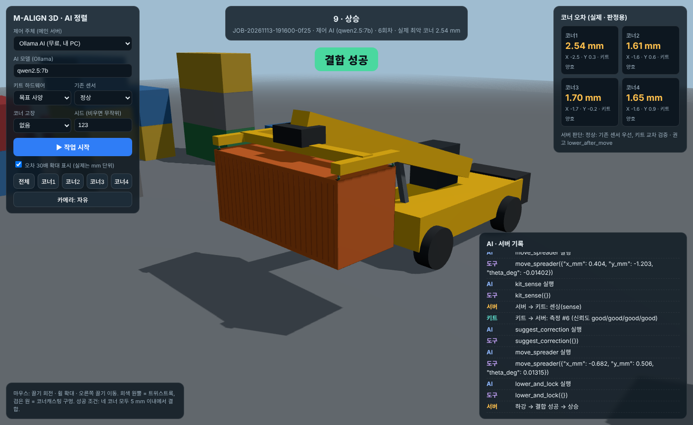

# 3D AI 정렬 시뮬레이터

AI(메인 서버)가 보조 키트와 리치스태커를 직접 지휘하는 과정을 3D 게임처럼 보여 줍니다.

## 실행

1. (AI로 돌릴 때) [Ollama](https://ollama.com) 설치 후 `ollama pull qwen2.5:7b` — 무료, 인터넷 없이 내 PC에서 동작
2. `app\RUN_WITH_PYTHON.cmd` (또는 EXE) 실행 → 시뮬레이터 화면의 **🎮 3D 화면으로 보기**
3. 왼쪽 패널에서 제어 주체·조건을 고르고 **▶ 작업 시작**

three.js(r187, MIT)는 프로그램에 들어 있어 3D 화면도 인터넷 없이 열립니다.

## 화면

| 영역 | 내용 |
|---|---|
| 가운데 3D | 야드, 컨테이너(코너캐스팅 구멍=검은 원), 리치스태커·붐·스프레더(트위스트록=원뿔) |
| 왼쪽 | 제어 주체(Ollama AI / 규칙 자동조종), AI 모델, 키트 하드웨어, 기존 센서, 코너 고장, 시드, 오차 30배 확대, 카메라(전체·코너1~4·따라가기) |
| 위 | 현재 단계, 작업 번호, 회차, 실제 최악 코너 / 끝나면 결과(결합 성공·안전 정지·결합 실패) |
| 오른쪽 위 | 코너별 실제 오차(판정용, AI와 키트는 모름)와 키트 신뢰도 |
| 오른쪽 아래 | AI 발언, 도구 호출, 키트 보고, **안전장치 거부** 기록 |

장면 순서: 접근 → 센싱 범위 진입 → (센싱 → 보정 이동) 반복 → 하강 → 결합(트위스트록 회전, 초록) → 컨테이너를 문 채 상승.
실패하면 트위스트록이 빨갛게 변하고, 안전 정지면 하강하지 않습니다.

## AI가 쓰는 도구

| 도구 | 내용 |
|---|---|
| `approach_container` | 원거리 대략 위치로 접근, 센싱 범위(±30 mm) 진입 |
| `kit_sense(remeasure)` | 키트에 센싱 지시 → 4코너 값·신뢰도 |
| `read_machine_sensor` | 리치스태커 기존 센서 값 |
| `suggest_correction` | 규칙 조언자(우선순위 5상황·4코너 종합)의 권고 |
| `move_spreader(x, y, θ)` | 보정 이동 |
| `lower_and_lock` | 하강·결합·상승 |
| `stop_job(reason)` | 안전 정지 |

## 안전장치 (규칙이 막고 AI에 이유를 알림)

- 센싱 없이 연속 이동 금지 (이동 → 센싱으로 확인 → 다음 이동)
- 한 번 이동 한도: ±40 mm, ±0.5°
- 하강은 새 센싱 결과가 있고, 키트가 무효가 아니며, 최악 코너(측정값, 또는 마지막 이동 후 예상값) ≤ 4 mm이고, 기존 센서가 정상인데 키트와 크게 어긋나지 않을 때만
- 거부되면 AI는 `{"refused": "이유"}` 를 받고, 화면 기록에 **안전장치**로 표시

## 확인한 것 / 못한 것

- 가짜 AI 모델로 전체 흐름을 시험했어요(`tests/test_ai_3d.py`): 접근 → 센싱 → 일부러 너무 이른 하강 → 안전장치 거부 → 보정 계속 → 결합 성공.
- 같은 도구를 쓰는 규칙 자동조종으로도 같은 결과가 나와요. Ollama가 꺼져 있으면 연결 실패를 알리고 중단합니다.
- 3D 화면은 브라우저(Chromium) 렌더링으로 확인했어요.
- **실제 Ollama 모델이 이 도구들을 얼마나 잘 쓰는지는 이 개발 환경에서 시험하지 못했습니다.** 모델이 엉뚱한 지시를 내려도 안전장치가 위험한 하강은 막습니다.
