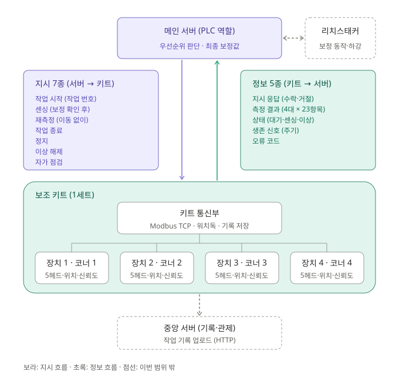

# MAS-kit 보조 키트 단계별 구현 계획

목표: 보조 키트가 **메인 서버에 정보를 보내고, 메인 서버의 지시를 받아 동작**하는 현장 장치(필드 디바이스)가 되는 것.

**진행 범위: 0~3단계 (소프트웨어·시뮬레이션).** 4~6단계는 참고용으로 남겨 둔 향후 과제이며 이번에는 진행하지 않습니다.
기준 버전: GitHub `enterryena/MAS-kit-Magnetic-Sensor` main v3.5.4 (`18ae279`).

## 한눈에 보기

| 단계 | 이름 | 성격 | 핵심 산출물 | 상태 |
|---|---|---|---|---|
| 0 | 시뮬레이터 + 서버 지시형 연동 | 소프트웨어 | v3.5.4 시뮬레이터, 키트 링크(HTTP), 예제 서버 | 완료 (브랜치) |
| 1 | 지시·데이터 확정 | 소프트웨어 | 지시 7종, 측정 23항목, 워치독, 역할 재배치 | 완료 (브랜치) |
| 2 | Modbus TCP 인터페이스 | 소프트웨어 | 레지스터 표, 키트 Modbus 서버, 서버 Modbus 마스터 | 다음 (3단계 먼저 진행) |
| 3 | 서버 판단 로직 + 가상 리치스태커 | 소프트웨어 | 우선순위 규칙, 4코너 종합, 종료·하강 인터록, 비교 실험 | 완료 (브랜치) |
| 4 | 장치 1대 시제품 | 하드웨어 | 측정 회로, MCU 펌웨어, 교정 절차, 벤치 시험 | 범위 밖 (향후) |
| 5 | 키트 4대 통합 시험 | 하드웨어 | 키트 통신부, 축소 모형 위 6회 보정 루프 | 범위 밖 (향후) |
| 6 | 현장 연계 준비 | 협의·설계 | 제조사 인터페이스, 서버 위치, 안전 인터록 | 범위 밖 (향후) |

단계 1~3은 실제 장비 없이 진행합니다. 3단계가 끝나면 키트·메인 서버·가상 리치스태커가 시뮬레이션 안에서 전체 작업 순서대로 동작합니다. 4~6단계는 부품과 외부 협의가 필요해 이번 범위에서 제외합니다.

---

## 0단계 · 완료된 것

- v3.5.4 시뮬레이터: Maxwell 21개 케이스, 4코너 폐루프, 격자·LM·이력 추정, 성공률 계산, 사례 누적.
- 키트 링크(`app/maskit_link.py`): 메인 서버 지시(`start_job` / `sense` / `end_job` / `stop`) → 1회 센싱 → 장치 4대 묶음 저장·전송, 서버 끊김 시 보관 후 순서대로 재전송, 재시작해도 상태 유지.
- 예제 메인 서버(`app/server_example/maskit_main_server.py`): 자동·수동 모드.
- 테스트 8종 통과. 위치: 브랜치 `feature/kit-link-batch-upload` (아직 GitHub에 올리지 않음).

---

## 1단계 · 지시와 데이터 확정 (완료)

> 결과: Python 엔진 이식(`app/maskit_engine.py`, v3.5.4 JS와 시행 단위 일치), 장치 계산(`app/kit_device.py`), 키트 v2(`app/maskit_link.py`), 서버 판단(`app/server_example/maskit_server_logic.py`). 역할 분리 후에도 격자 68/1000, 이력 586/1000 그대로. 규약은 [`전송_프로토콜.md`](전송_프로토콜.md).

**목표:** 키트가 주고받는 내용을 최종 형태로 맞춥니다. 전달 방식(HTTP/Modbus)과 무관한 "무엇을"을 확정하는 단계예요.

**할 일**
1. 지시 7종 완성: 기존 4종에 `resense`(이동 없이 같은 회차 재측정), `fault_reset`(이상 해제), `self_test`(자가 점검) 추가.
2. 측정 23항목 구현
   - 식별·순번 6: 장치 번호, 코너, 작업 번호, 회차, **측정 번호**(재측정 포함, 센싱마다 +1), 측정 시각
   - 원시값 5: Xp·Xm·Yp·Ym·Ref (μH)
   - 추정 3: X, Y, **공극**(지금은 계산 후 버리는 값을 반환)
   - 신뢰도 5: 추정 잔차, 외삽 여부(±30 mm 밖), 공극 범위 초과, 헤드 이상 플래그, 종합 등급(양호/주의/무효)
   - 진단 4: 코일 온도, 공급 전압, 교정·펌웨어 버전, 오류 코드 (시뮬레이터에서는 가상값)
3. 상태에 **이상(FAULT)** 추가: 자가 점검 실패나 장치 응답 없음일 때. `fault_reset` 전에는 작업 시작 거부.
4. **워치독·생존 신호:** 키트가 주기적으로 생존 신호를 보내고, 메인 서버 신호가 정해진 시간 끊기면 진행 중인 작업을 스스로 멈추고 기록.
5. **역할 재배치**
   - 키트: 코너별 추정과 신뢰도까지. 4코너 보정값은 참고용.
   - 서버: 4코너 종합, 우선순위, 최종 보정값, **이력 추정**. 서버만 실제로 반영한 이동량을 알기 때문.

**완료 기준**
- 지시 7종과 23항목 모두 테스트 통과.
- 이력 추정을 서버로 옮긴 뒤에도 v3.5.4 기준 수치 재현 (기준 가정, 시드 2026, 1,000회: 격자 68회 / 이력 586회 성공).
- 워치독: 서버를 끊으면 설정 시간 안에 키트가 작업을 멈춤.

---

## 2단계 · Modbus TCP 인터페이스

**목표:** 공장 자동화에서 가장 흔한 방식으로 지시를 주고받아, 어떤 PLC나 SCADA에도 붙을 수 있게 합니다.

**할 일**
1. **레지스터 표 확정**
   - 서버 쓰기: 명령 코드, 명령 순번, 작업 번호, 회차, (이력용) 실제 반영 이동량
   - 키트 쓰기: 상태, 처리한 명령 순번, 측정 번호, 시각, 장치 4대 × 23항목, 키트 참고 보정값, 생존 카운터
   - 고정 정보: 장치 4대 번호, 교정 버전
   - 숫자는 float32(2칸), 워드 순서 명시. 장치당 약 30~35칸.
2. **핸드셰이크:** 서버가 명령과 순번을 쓰면 → 키트가 "센싱 중" → 결과를 모두 쓴 뒤 **마지막에** 처리 순번과 "완료"를 씀 → 서버는 순번이 일치할 때만 읽음 (중간값·지난값 읽기 방지).
3. 키트를 Modbus 서버로 구현 (표준 라이브러리만, 기능 코드 3·4·6·16).
4. 예제 메인 서버를 Modbus 마스터로 동작하게 확장.
5. HTTP 경로는 **기록 업로드 전용**으로 유지 (Modbus는 최신값만 있고 기록이 남지 않으므로).

**완료 기준**
- 일반 Modbus 점검 도구로 레지스터 읽기·쓰기 확인.
- Modbus만으로 작업 1건(6회) 끝까지 진행되는 종단 시험 통과.
- 통신을 끊었을 때 워치독이 동작하고, 기록은 PC 저장 후 나중에 업로드됨.

---

## 3단계 · 서버 판단 로직과 가상 리치스태커 (완료)

> 결과와 실험 표: [`3단계_메인서버_가상현장.md`](3단계_메인서버_가상현장.md). 메인 서버는 규칙 기반이고, 무료 로컬 AI(Ollama)는 허용 명령만 쓰는 운영 비서로 선택 연결합니다.

**목표:** 메인 서버의 "판단"을 시험할 수 있게 만듭니다. 실제 서버를 만드는 쪽이 그대로 가져다 쓸 수 있는 참고 구현이에요.

**할 일**
1. **가상 리치스태커:** 기존 센서값 생성(정상 / 불안정 / 정보 부족 시나리오), 보정 명령 수신 → 이동(구동 오차 포함) → 완료 보고.
2. **센서 우선순위 5개 상황**
   - 정상: 기존 센서 우선, 키트는 교차 검증
   - 기존 센서 불안정: 키트 신뢰도 평가 후 우선순위 상승
   - 기존 센서 정보 부족: 키트 값이 유효하면 키트 우선
   - 단독 판단 불충분: 상호 보완
   - 둘 다 신뢰도 부족: 보정 보류 → 재측정 또는 안전 정지
3. **4코너 종합:** 신뢰도 가중 강체 맞춤, 튀는 코너 제외(하나씩 빼고 다시 맞춤), 남은 코너 수별 규칙(4·3 / 대각선 2 / 같은 변 2 / 1 / 0).
4. **종료·하강 인터록:** 최악 코너 ≤ 허용 오차, 신뢰도 조건 충족, 두 센서 불일치 없음 → 그때만 하강 허용.
5. **비교 실험(각 1,000회):** 4코너 동일 가중 / 고정 기준 코너 / 신뢰도 가중 + 튀는 값 제외. 조건별(기준·목표 하드웨어, 한 코너 고장, 기존 센서 불안정)로 비교.

**완료 기준**
- 시나리오별 성공률, 잘못된 하강 허용률, 평균 회차, 재측정 비율 표.
- 둘 다 신뢰도가 부족할 때 하강이 **절대** 허용되지 않음을 시험으로 확인.

---

## 4단계 · 장치 1대 시제품 (범위 밖 · 향후)

**목표:** 실제 코일로 측정해서 시뮬레이터(Maxwell)와 맞는지 확인합니다.

**핵심 요구 사양 (v3.5.4 데이터 기준)**

| 항목 | 값 |
|---|---|
| 측정 대상 | 약 1,106~1,132 μH |
| 필요 분해능 | 약 0.01 μH (상대 10만분의 1, 유효 17비트 이상) |
| 위치 감도 | 1 mm당 0.02~0.36 μH |
| 공극 감도 | 1 mm당 0.5~2.4 μH (위치보다 약 10배) |
| 계산 | 격자 추정 약 6만 회 연산, 모델 약 6.5 KB |

**할 일**
1. 인덕턴스 측정 방식 선정 (공진 주파수 측정 등)과 5채널 회로.
2. MCU 선정 (Cortex-M4F급이면 계산은 충분), 펌웨어: 측정 → 온도 보정 → 격자 추정 → 신뢰도 → 결과.
3. **교정 절차:** 장치별 기준값(L0)과 온도 계수 측정, 교정 버전 기록.
4. 자가 점검: 코일 단선·단락, 전압, 온도.
5. 벤치 시험: XY 이동 지그 위 코너캐스팅 모형으로 Maxwell 21개 케이스 일부 재현.

**완료 기준**
- 실측 응답과 FEM 응답의 차이가 정해 둔 기준 이내. 기준은 4단계 시작 때 정함. 참고로 현재 FEM 해석 오차는 약 1 μH.
- 측정 잡음이 시뮬레이터 가정(0.1~0.3 μH) 이하.

---

## 5단계 · 키트 4대 통합 시험 (범위 밖 · 향후)

**목표:** 장치 4대 + 키트 통신부 + 메인 서버로 실제 보정 루프를 돌립니다.

**할 일**
1. 키트 통신부: 장치 4대 연결(유선), 묶음 구성, Modbus 서버, 기록 저장.
2. 축소 또는 실물 크기 코너 모형 4개와 이동 장치(수동 또는 XY 스테이지).
3. 메인 서버(3단계 로직)로 6회 보정 루프 실행, 결과 기록.

**완료 기준**
- 반복 시험 성공률을 시뮬레이터 예측(목표 하드웨어 가정 99.7%)과 비교한 표.
- 한 장치를 일부러 고장 냈을 때 튀는 값 제외와 인터록이 동작.

---

## 6단계 · 현장 연계 준비 (범위 밖 · 향후)

| 항목 | 확인할 것 |
|---|---|
| 리치스태커 인터페이스 | 제조사가 외부 보정 명령을 받는지, 방식(OPC UA / CAN·J1939 게이트웨이), 허용 범위 |
| 메인 서버 위치 | 권장: 리치스태커 탑재 산업용 PC(제어) + 항만 중앙 서버(배정·기록·관제) |
| 안전 | 하강 인터록 위치, 비상 정지, 작업 구역 분리 |
| 설치 | 스프레더 장착 위치, 배선, 방진·방수, 진동 |

---

## 결정이 필요한 것

| 결정 | 필요한 시점 | 현재 제안 |
|---|---|---|
| 메인 서버 위치 (탑재 / 중앙) | 2단계 전 | 탑재 PC + 중앙 서버 혼합 |
| 허용 오차 기준 | 3단계 | ±5 mm (시뮬레이터 판정) |
| 신뢰도 등급 기준값 | 3단계 | 시뮬레이터 실험으로 결정 |

## 한계 (현재 기준)

- 모든 성공률은 FEM 기반 가상 결과이며 실제 장비 성능이 아닙니다.
- 기울기(pitch/roll)는 추정하지 않습니다 (시뮬레이터 내부 정답에만 존재).
- 3~5 mm 미세 정밀도는 해석 오차(약 1 μH) 수준이라 아직 입증하지 못했습니다.
