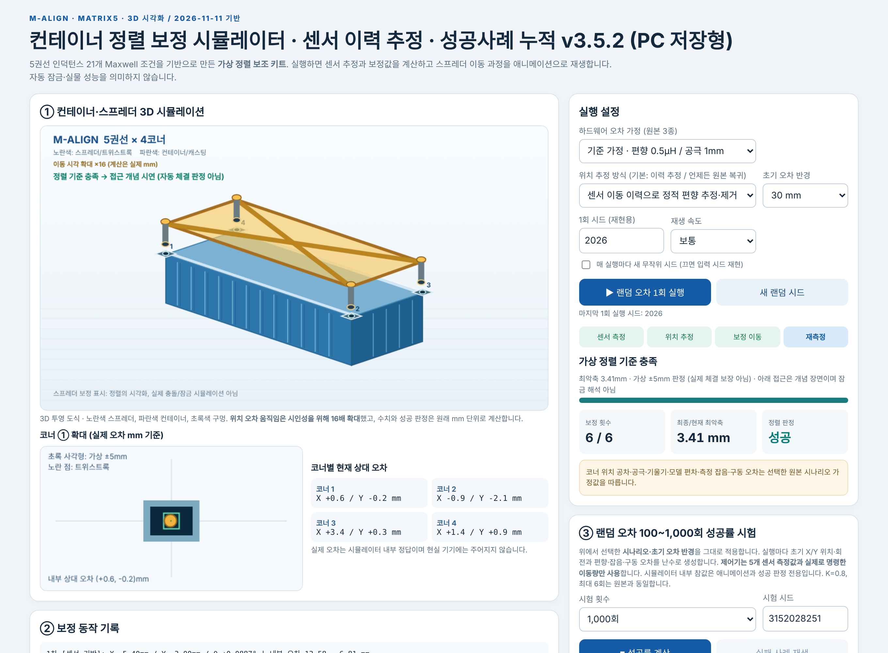
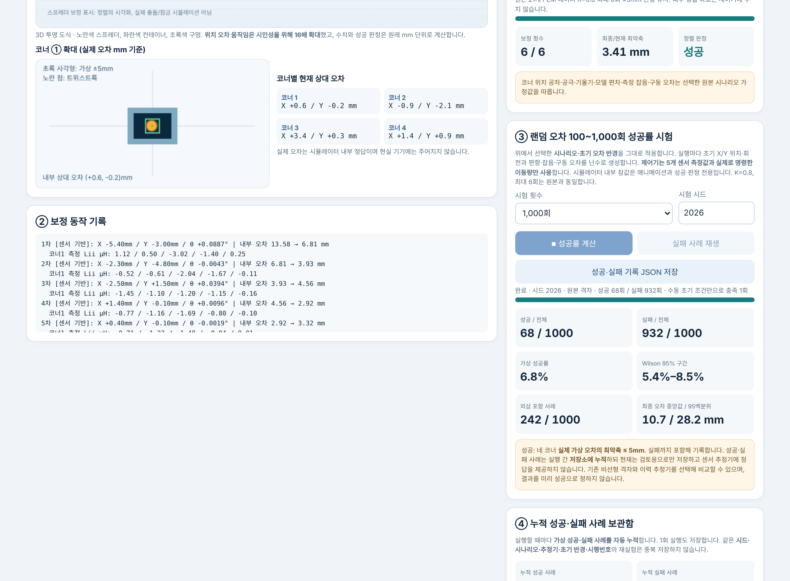
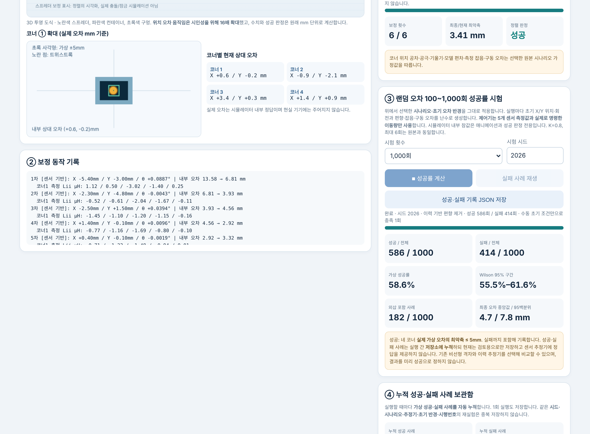

# 시뮬레이터 사용 안내

## 0. 하는 일

스프레더가 어긋난 위치에서 출발해 "측정 → 위치 추정 → 이동"을 최대 6번 반복합니다. 네 모서리 모두 오차 5 mm 이내면 성공입니다.
센서 응답은 Ansys Maxwell 해석 21건에서 가져왔습니다.

## 1. 하드웨어 오차 가정

| 선택지 | 의미 | 답하는 질문 |
|---|---|---|
| FEM 기준 가정 (편향 0) | 센서·장비가 완벽하다고 봄 | 이 원리로 정렬이 되긴 하는가 (상한) |
| 목표 가정 | 만들어야 할 사양 | 이 사양으로 만들면 되는가 (실험대 합격 기준 후보) |
| 기준 가정 | 보정 대책 없이 흔히 생길 오차 | 대책 없이 만들면 어떻게 되는가 (최악 아님) |

각 시나리오에 들어 있는 오차 (표준편차, 가정값)

| 항목 | 뜻 | 목표 | 기준 |
|---|---|---|---|
| 편향 | 센서별로 고정된 어긋남 (제작 편차·교정 오차). 정렬 중 변하지 않음 | 0.25 μH | 0.5 μH |
| 측정 잡음 | 잴 때마다 무작위로 흔들리는 값 | 0.2 μH | 0.3 μH |
| 공극 오차 | 센서와 컨테이너 윗면 사이 높이가 설계(20 mm)와 다른 정도 | 0.3 mm | 1 mm |
| 기울기 | 센서면이 컨테이너 윗면과 평행하지 않은 정도 | 0.05° | 0.2° |
| 코너 공차 | 컨테이너 네 구멍 위치의 제작 오차 | 0.7 mm | 3 mm |
| 이동 오차 | 스프레더가 명령만큼 정확히 움직이지 못하는 정도 | 0.2 mm | 0.5 mm |

**편향 0.5 μH의 크기**: 센서 인덕턴스(약 1,120 μH)의 0.045%입니다. 정중앙 근처에서는 1 mm 움직여도 신호가 0.1~0.3 μH밖에 변하지 않아, 0.5 μH 편향은 "2~5 mm 벗어났다"는 착각을 만듭니다. 그래서 기준 가정에서는 이미 맞춰진 모서리를 다시 밀어내는 장면이 보입니다. 멀리 벗어났을 때(신호 3~23 μH)는 거의 문제가 되지 않습니다.

## 2. 위치 추정 방식

| 선택지 | 방법 |
|---|---|
| 기존 격자 추정기 (원본) | 그 순간의 센서값 5개만 보고 Maxwell 응답표에서 가장 비슷한 위치를 찾음. 고정 편향을 위치와 구분하지 못함 |
| 이력 추정 (권장 비교안) | 이동 전후 센서값 변화를 함께 봄. 정렬 중 변하지 않는 편향은 빼면 사라짐. 첫 측정은 기존 방식, 두 번째부터 적용 |
| 격자 + LM (이전 실험안) | 기존 방식에 국소 미세조정. 효과 거의 없음 (기준 가정 6.8 → 7.5%) |

이력 추정은 편향이 정렬하는 동안 변하지 않아야 효과가 있습니다. 측정할 때마다 공극이 크게(약 1 mm) 흔들리면 효과가 사라집니다.
기준 가정은 코너 공차 3 mm와 이동 오차 때문에 센서가 완벽해도 약 72~79%가 상한입니다.

## 3. 초기 오차 반경

처음 스프레더가 내려왔을 때 어긋난 정도의 최대 범위입니다.
10 / 20 / 30 mm는 Maxwell 데이터 범위 안, 40 mm는 범위 밖이라 외삽입니다. 문헌상 트위스트록 체결 요구 정확도는 2~5 cm입니다.

## 4. 시드

무작위 초기 조건의 시작 번호입니다. 같은 시드는 항상 같은 결과를 냅니다. "매 실행마다 새 무작위 시드"를 켜면 매번 달라지며, 1,000회 성공률은 ±1~1.5%p 정도 움직입니다. 발표 수치는 시드 2026으로 고정합니다.

## 5. 결과 읽는 법

| 항목 | 뜻 |
|---|---|
| 가상 성공률 | 네 모서리 모두 5 mm 이내로 끝난 비율 |
| Wilson 95% 구간 | 같은 조건으로 다시 돌리면 성공률이 대부분 들어올 범위 |
| 최종 오차 중앙값 / 95백분위 | 절반은 중앙값 이하, 95%는 95백분위 이하로 끝남 |
| 수동 초기 조건만으로 충족 | 센서 없이 처음 위치 그대로도 성공이었던 횟수 |
| 외삽 포함 사례 | 반복 중 ±30 mm 밖을 지나 신뢰도가 낮은 횟수 |

## 6. 누적 사례 보관함

실행마다 성공·실패가 자동으로 쌓입니다(같은 조건·시드·시행번호는 한 번만). 지금은 기록용이며 제어기가 학습하지 않습니다.
실제 장비에서는 트위스트록 잠금 성공 순간이 "오차 0"인 정답이므로, 이런 기록으로 실제 센서 응답을 학습하는 것이 다음 단계 아이디어입니다.
