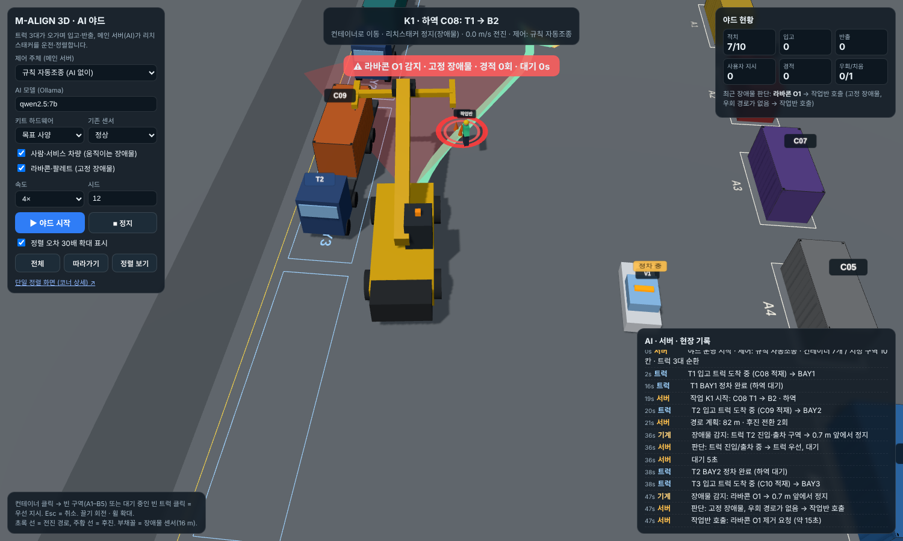
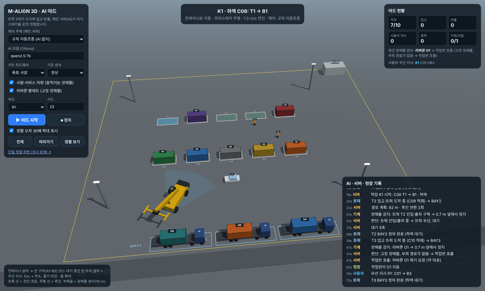

# AI 컨테이너 야드 (3D)

데스크톱 프로그램의 `/3d` 화면 (단일 정렬 화면은 `/3d-align`). 메인 서버(Ollama AI 또는 규칙 자동조종)가 야드 전체를 운영한다.

## 무엇이 일어나나
| 항목 | 동작 |
|---|---|
| 트럭 | T1–T3 세 대가 순환. 입고 트럭은 컨테이너를 싣고 BAY1–3에 정차 → 리치스태커가 빈 지정 구역(A1–A5, B1–B5)에 하역 |
| 반출 | 지정 구역 10칸이 다 차면(입고 예정 포함) 다음 트럭은 빈 차로 와서, 가장 오래 있던 컨테이너를 싣고 나감 |
| 사용자 지시 | 컨테이너 클릭 → 빈 구역(노란색) 또는 대기 중인 빈 트럭 클릭. 다음 작업으로 우선 처리 (진행 중 작업은 끝까지) |
| 주행 | 전진·후진·조향만 사용, 최소 회전반경 8 m. 제자리 회전 없음. 경로는 hybrid A* (`app/yard_world.py`) |
| 정렬·결합 | 컨테이너 앞에 서면 기존 M-ALIGN 키트 작업(센싱 → 보정 → 하강·결합)을 그대로 수행 |

## 장애물
리치스태커 센서(전·후방 16 m)가 경로 위 장애물을 보면 정지하고, 메인 서버가 결정한다.

| 종류 | 예 | 서버 판단 (규칙 기준, AI도 같은 도구) |
|---|---|---|
| 움직이는 대상 | 작업자 W1·W2, 서비스 차량 V1 | 경적 → 잠시 대기 → 안 비키면(통화 중 등) 우회 |
| 고정 장애물 | 라바콘, 팔레트 | 우회가 짧으면(+30 m 미만) 우회, 아니면 작업반 호출(약 15초) |
| 트럭 진입·출차 | 이동 중인 트럭과 그 구역 | 트럭 우선 대기, 오래 막히면 우회 |
| 목표 지점이 막힘 | 구역 앞 장애물 | 고정이면 작업반, 사람·차량이면 경적 |

안전장치(규칙)가 AI의 잘못된 선택을 거부하고 이유를 알려준다: 사용자 지시보다 다른 작업을 먼저 고름, 찬 구역에 내리기, 고정물에 경적, 사람에게 작업반 호출 등. Ollama가 응답하지 않으면 규칙 자동조종이 대신 결정한다.

## 확인 결과 (`app/tests/test_yard.py`)
- 경로: 회전반경 이내, 제자리 회전 없음, 후진 사용, 전 구간 충돌 없음
- 규칙 자동조종(가상 시간 약 1500초, 시드 4·6·11·15·16): 입고 6–7, 반출 4–5, 접촉 0
- 가짜 Ollama로 AI 경로: 잘못된 선택 거부 → 수정, 사용자 지시 우선, 키트 정렬 성공

실제 Ollama 모델로는 아직 시험하지 않음 (가짜 모델만).
