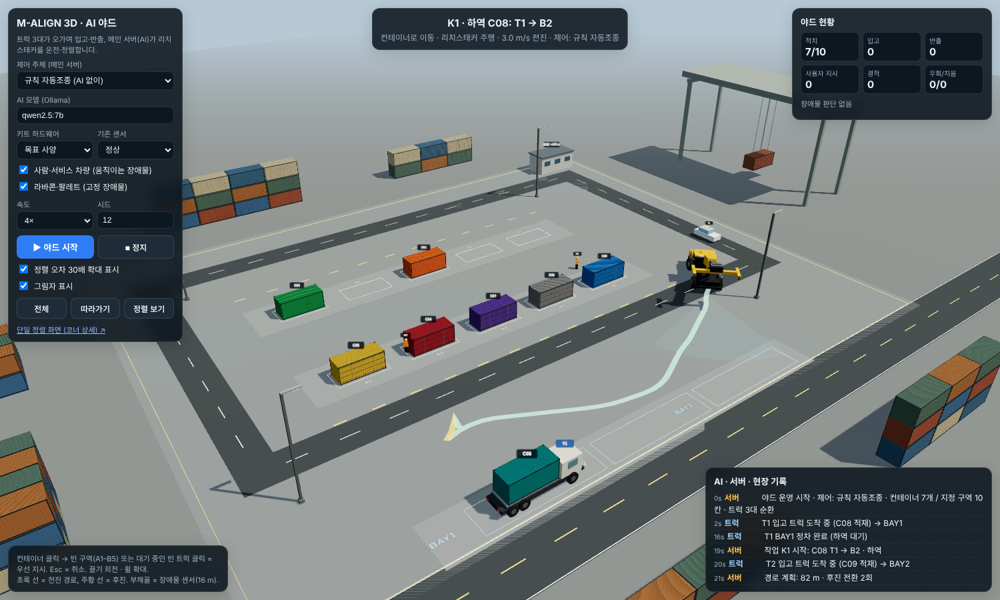
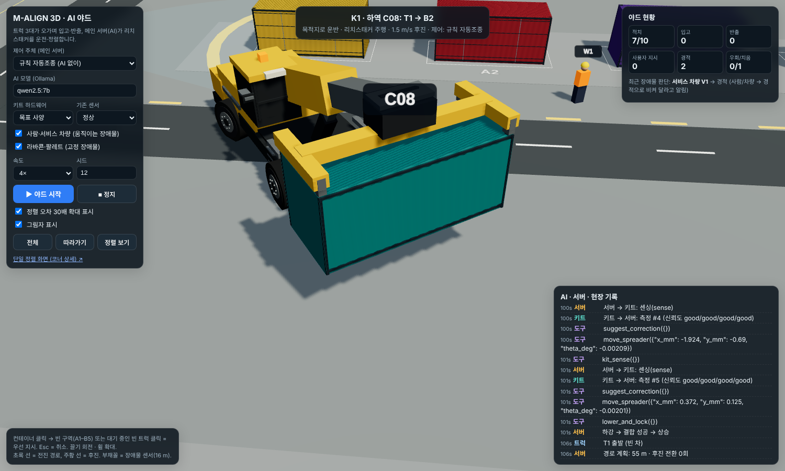

# AI 컨테이너 야드 (3D)

데스크톱 프로그램의 `/3d` 화면 (단일 정렬 화면은 `/3d-align`). 메인 서버(Ollama AI 또는 규칙 자동조종)가 야드 전체를 운영한다.

## 무엇이 일어나나
| 항목 | 동작 |
|---|---|
| 트럭 | T1–T3 세 대가 순환. 입고 트럭은 컨테이너를 싣고 BAY1–3에 정차 → 리치스태커가 빈 지정 구역(A1–A5, B1–B5)에 하역 |
| 반출 | 지정 구역 10칸이 다 차면(입고 예정 포함) 다음 트럭은 빈 차로 와서, 가장 오래 있던 컨테이너를 싣고 나감 |
| 사용자 지시 | 컨테이너 클릭 → 빈 구역(노란색) 또는 대기 중인 빈 트럭 클릭. 다음 작업으로 우선 처리 (진행 중 작업은 끝까지) |
| 주행 | 전진·후진·조향만 사용, 최소 회전반경 8 m. 제자리 회전 없음. 경로는 hybrid A* (`app/yard_world.py`) |
| 정렬·결합 | 컨테이너 앞에 서면 기존 M-ALIGN 키트 작업(센싱 → 보정 → 하강·결합)을 그대로 수행 |

## 장애물
리치스태커 센서(전·후방 16 m)가 경로 위 장애물을 보면 정지하고, 메인 서버가 결정한다.

| 종류 | 예 | 서버 판단 (규칙 기준, AI도 같은 도구) |
|---|---|---|
| 움직이는 대상 | 작업자 W1·W2, 서비스 차량 V1 | 경적 → 잠시 대기 → 안 비키면(통화 중 등) 우회 |
| 고정 장애물 | 라바콘, 팔레트 | 우회가 짧으면(+30 m 미만) 우회, 아니면 작업반 호출(약 15초) |
| 트럭 진입·출차 | 이동 중인 트럭과 그 구역 | 트럭 우선 대기, 오래 막히면 우회 |
| 목표 지점이 막힘 | 구역 앞 장애물 | 고정이면 작업반, 사람·차량이면 경적 |

안전장치(규칙)가 AI의 잘못된 선택을 거부하고 이유를 알려준다: 사용자 지시보다 다른 작업을 먼저 고름, 찬 구역에 내리기, 고정물에 경적, 사람에게 작업반 호출 등. Ollama가 응답하지 않으면 규칙 자동조종이 대신 결정한다.

## 확인 결과 (`app/tests/test_yard.py`)
- 경로: 회전반경 이내, 제자리 회전 없음, 후진 사용, 전 구간 충돌 없음
- 규칙 자동조종(가상 시간 약 1500초, 시드 4·6·11·15·16): 입고 6–7, 반출 4–5, 접촉 0
- 가짜 Ollama로 AI 경로: 잘못된 선택 거부 → 수정, 사용자 지시 우선, 키트 정렬 성공

실제 Ollama 모델로는 아직 시험하지 않음 (가짜 모델만).

## 기존 센서 동작·보정값을 그대로 따르는지 (감사: `app/tools/audit_yard_alignment.py`)
야드에서 컨테이너를 집을 때마다 기존 단일 정렬 작업(키트 링크 → 메인 서버 판단 → 보정 이동 → 인터록 → 결합)을 그대로 호출한다. 감사 도구가 실제 키트 링크(시뮬 소스)로 야드를 돌리며 작업마다 확인한 결과 (12건):

| 확인 | 결과 |
|---|---|
| 센싱마다 키트 묶음 1개, 유닛당 23항목, 측정 번호 증가 | 12/12 |
| 보정 이동은 항상 새 센싱 뒤 (센싱 1회당 이동 1회) | 12/12 |
| 보정값 = 메인 서버 판단기(키트 추정 + 기존 센서 가중)의 값 | 12/12 |
| 하강은 예상 최악 코너 4 mm 이하일 때만, 결합 여부 = 실제 5 mm 이내 | 12/12 |
| 같은 시드를 야드 없이 단독 작업으로 다시 돌렸을 때 이동·결과 완전히 동일 | 12/12 |

즉 야드는 정렬 계산에 손대지 않고, 접근·운반만 추가한다.

## 현실성 점검
| 항목 | 값 | 근거/비고 |
|---|---|---|
| 최소 회전반경 | 8 m | 20 ft 리치스태커 외측 회전반경 약 8 m급 |
| 주행 속도 | 전진 3 m/s(10.8 km/h), 후진 1.5 m/s | 야드 내 운행 속도 수준, 최고 속도(약 25 km/h)보다 낮게 |
| 가속/감속 | 0.8 / 1.5 m/s² (비상 4) | 3 m/s에서 정지거리 약 3 m < 센서 16 m |
| 호이스트 | 0.45 m/s | 실제 약 0.25–0.45 m/s (이번에 1.2 → 0.45로 수정) |
| 센싱 높이 | 캐스팅 위 20 mm | Maxwell 21케이스 기준 간극 (이번에 0.32 m → 20 mm로 수정) |
| 트럭 적재면 | 1.5 m | 섀시 트레일러 수준 |
| 내려놓기 | 키트 미사용 | 키트는 스프레더 아래 컨테이너 캐스팅을 보는 장치라, 바닥/트레일러 위치 맞춤은 범위 밖 |
| 정렬 시작 오차 | 기존 접근 모델(±30 mm, R0) | 야드 주행의 최종 정지 오차와 직접 연결하지 않음 (기존 시뮬과 동일 가정) |

## 실패 재시도 · 성공 누적 · 유사 상황 유도 (`app/case_memory.py`)
| 기능 | 동작 |
|---|---|
| 누적 | 정렬이 끝날 때마다 사례 저장 (`Link/yard_cases.sqlite3`, 재시작해도 유지): 상황, 고른 계획, 결과, 실패 원인 |
| 상황 | 키트 첫 센싱 직후 서버가 아는 것만: 하드웨어, 기존 센서 상태, 키트 종합 신뢰도·무효 코너, 키트-기존 센서 불일치, 첫 추정 거리, (재시도면) 이전 실패 원인. 시뮬 진실(센서 몰래 편향 등)은 기록만 하고 판단에 안 씀 |
| 계획 | STD 기본(기존 센서 함께, K 0.8, 6회) / KIT 키트 우선 / SOFT 완만(K 0.6, 8회) / KIT_SOFT |
| 유도 | 비슷한 사례일수록 큰 가중치로 계획별 성공률·오하강 위험을 계산 → 성공률 − 4×오하강 위험이 가장 높은 계획. 근거 적은 계획은 조금씩 시험 |
| 안전 | 키트 우선(기존 센서 교차확인 제외)은 키트 첫 센싱이 '양호'이거나, 기존 센서가 키트와 어긋나거나, 기존 센서가 없을/불안정할 때만. 하강 인터록(4 mm)·안전장치는 그대로 |
| 재시도 | 최대 3회. 직전에 실패한 계획은 다시 안 씀, 원인별 우선 계획(불일치→키트 우선, 수렴 부족→회차↑, 오하강→완만). 오하강·신뢰도 부족·초기 오차 큼이면 스프레더 올리고 후진 → 재진입 |

같은 작업 흐름(현장 조건 섞임: 기존 센서 정상/불안정/편향/꺼짐, 키트 고장, 하드웨어 목표/기준) 1000건 비교 (`app/tools/learning_experiment.py`):

| | 첫 시도 성공 (앞/뒤 500) | 3회 안 성공 (앞/뒤) | 평균 시도 | 오하강 |
|---|---|---|---|---|
| 고정 (기존 STD만, 같은 방식 재시도) | 75.8% / 77.8% | 87.8% / 86.6% | 1.38 | 27 |
| 사례 유도 | 78.2% / 81.2% | 90.8% / 91.0% | 1.32 | 28 |

효과는 크지 않지만 일관됨(3회 안 성공 약 +4%p, 시도 횟수 감소). 오하강은 늘지 않게 맞춤: 처음엔 키트 우선 계획이 기준 가정 하드웨어에서 오하강을 늘려서, 안전 규칙과 오하강 감점을 추가함. 감사 도구는 사례로 고른 계획까지 포함해 단독 재현이 동일함을 확인.
