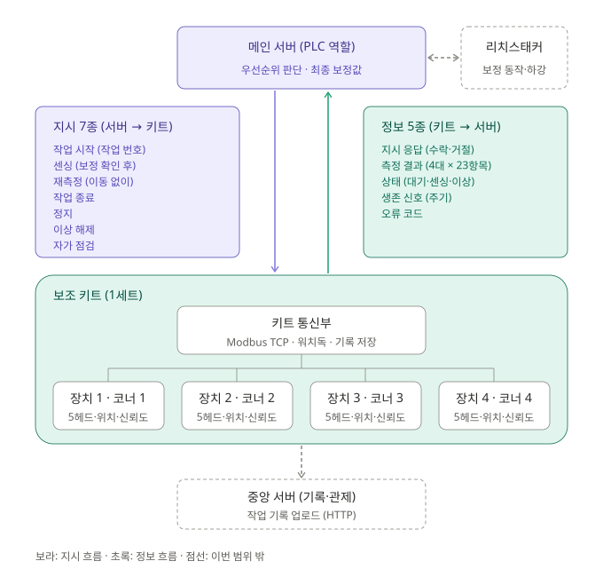

# 보조 키트 ↔ 메인 서버 규약 (v3.6.0 · 1단계)

보조 키트는 공장 자동화의 **현장 장치(필드 디바이스)** 입니다. 메인 서버가 지시하면 그대로 동작하고, 결과와 상태를 보고합니다.
키트는 기계를 제어하지 않습니다. 4코너 종합·우선순위·최종 보정값·종료 판단은 **메인 서버**가 합니다.



## 1. 역할 분담

| 누가 | 하는 일 |
|---|---|
| 장치(코너별 4대) | 자기 코너 5헤드 측정 → 격자 위치 추정·공극 추정 → 신뢰도 판정 (`app/kit_device.py`) |
| 키트 통신부 | 4대 결과를 묶음 1개로 저장·전송, 지시 처리, 상태·이상·워치독 (`app/malign_link.py`) |
| 메인 서버 | 코너별 이력 추정(자기가 지시한 이동량 사용), 4코너 강체 맞춤 × K, 종료 판단, 기계 지시 (`app/server_example/`) |

이렇게 나눠도 v3.5.4 결과가 시행 단위로 같습니다(기준 가정·시드 2026·1,000회: 격자 68, 이력 586). `tests/test_split_reproduction.py` 참고.

## 2. 작업 순서

| 단계 | 누가 → 누구 | 내용 |
|---|---|---|
| 1 | 기계 | 컨테이너 쪽으로 이동해 작업 준비 |
| 2 | 기계 → 메인 서버 | 작업 준비 완료 |
| 3 | 메인 서버 → 키트 | `start_job` |
| 4 | 키트 → 메인 서버 | 센싱 1회 결과 묶음 (장치 4대 × 23항목) |
| 5 | 메인 서버 | 기계 센서와 비교(3단계 예정)·보정값 결정·기계에 보정 지시 |
| 6 | 메인 서버 → 키트 | 이동 확인 후 `sense` (값이 의심스러우면 이동 없이 `resense`) |
| 7~8 | | 4로 돌아감 (예: 6회) |
| 9 | 메인 서버 → 키트, 기계 | `end_job` 후 메인 동작(하강·결합) |

## 3. 키트 상태

```
IDLE ──start_job──► SENSING ──묶음──► WAITING ──sense / resense──► SENSING …
  ▲                                      │
  └────────────── end_job / stop ────────┘
IDLE / FAULT ──self_test──► SELF_TEST ──통과──► 원래 상태 / ──실패──► FAULT
어느 상태든 ──장치 고장·자가 점검 실패·워치독──► FAULT ──fault_reset──► IDLE
```

- **FAULT** 에서는 `start_job` 을 거절합니다(`command_ack` ok=false, note=`busy:FAULT`). 메인 서버가 원인을 확인하고 `fault_reset` 을 보내야 합니다.
- **워치독**: 작업 중 메인 서버와 `watchdog_s`(기본 10초) 동안 통신이 안 되면, 작업을 중단하고 FAULT(50)로 갑니다.
- 상태·회차·측정 번호는 PC에 저장되어 프로그램을 다시 켜도 이어집니다.

## 4. 지시 7종 (메인 서버 → 키트)

| type | 필드 | 동작 | 허용 상태 |
|---|---|---|---|
| `start_job` | `job_id`, `machine_id` | 작업 시작, 1회차 센싱 | IDLE |
| `sense` | `session_id`, `round_no`(생략 가능) | 다음 회차 센싱 (보정 동작 확인 후) | WAITING |
| `resense` | `session_id`, `round_no`(생략 가능) | 이동 없이 같은 회차 재측정 (회차당 `max_resense` 회까지) | WAITING |
| `end_job` | `session_id`, `result` | 작업 종료 → 대기 | SENSING / WAITING |
| `stop` | `reason` | 즉시 중단 | 모든 상태 |
| `fault_reset` | — | 이상 해제 → 대기 | FAULT |
| `self_test` | — | 장치 4대 자가 점검 | IDLE / FAULT |

모든 지시에는 `id` 를 붙이고, 키트는 같은 `id` 를 한 번만 실행하며 반드시 `command_ack`(ok, note)로 답합니다.

## 5. 정보 5종 (키트 → 메인 서버)

| 정보 | 형태 |
|---|---|
| 지시 응답 | 이벤트 `command_ack` |
| 측정 결과 | 묶음 `MALIGN_round_bundle_v2` (아래) |
| 상태 | 모든 업로드의 `kit_status` {state, session_id, round_no, measurement_id, fault_code} |
| 생존 신호 | 모든 업로드의 `heartbeat_seq` (대기 중 `heartbeat_s`, 작업 중 `active_poll_s` 간격) |
| 오류 코드 | 이벤트 `fault`, `sense_failed`, 장치별 `diag.error_code` |

### 측정 결과 묶음 — 장치 1대당 23항목

```json
{
  "schema": "MALIGN_round_bundle_v2", "kind": "round",
  "msg_id": "JOB-20261113-170512-a1b2|m002",
  "kit_id": "MALIGN-KIT-1A2B3C4D", "session_id": "JOB-20261113-170512-a1b2",
  "round_no": 1, "measurement_id": 2, "resense": true, "source": "simulation",
  "units": [
    {"corner": 1, "unit_id": "MALIGN-KIT-1A2B3C4D-U1", "job_id": "JOB-…", "round_no": 1,
     "measurement_id": 2, "measured_at": "2026-11-13T08:05:20.112Z",
     "heads": ["Xp","Xm","Yp","Ym","Ref"], "sensor_uH": [-0.04, 0.52, 0.24, 0.53, -0.12],
     "est_mm": {"x": 3.0, "y": -1.5}, "gap_mm": 0.21,
     "quality": {"rss_uH2": 0.08, "extrapolated": false, "gap_out_of_range": false,
                 "head_ok": [true,true,true,true,true], "grade": "good"},
     "diag": {"coil_temp_c": 25.0, "supply_v": 24.0, "fw_cal_version": "SIM-FEM21-v1", "error_code": 0}},
    "… 코너 2, 3, 4 …"
  ],
  "kit_reference": {"available": true, "fit_x_mm": 2.9, "fit_y_mm": -1.4, "fit_theta_deg": 0.0011,
                    "max_abs_est_mm": 3.4, "converged_hint": false}
}
```

| 묶음 | 항목 수 | 내용 |
|---|---|---|
| 식별·순번 | 6 | unit_id, corner, job_id, round_no, measurement_id(재측정 포함 +1), measured_at |
| 측정값 | 5 | Xp·Xm·Yp·Ym·Ref, **교정 기준(L0) 대비 변화량** μH. 실제 센서값은 약 1,106~1,132 μH |
| 추정 | 3 | 코너 오차 X·Y(컨테이너 좌표, mm), 공극 변화(mm) |
| 신뢰도 | 5 | 추정 잔차(μH²), 해석 범위 ±30 mm 밖 여부, 공극 ±3 mm 한계 도달, 헤드별 정상 여부, 종합 등급(good/caution/invalid) |
| 진단 | 4 | 코일 온도, 공급 전압, 펌웨어·교정 버전, 오류 코드 |

- 종합 등급 기준(잠정, 3단계에서 조정): 헤드 2개 이상 이상 → invalid / 외삽·공극 한계·헤드 1개 이상·잔차 > 1.0 μH² → caution / 그 외 good.
- 헤드가 3개 미만이면 추정하지 않고(`est_mm: null`) invalid 로 보냅니다.
- `kit_reference` 는 키트가 4코너를 같은 가중치로 맞춘 **참고값**이며, 서버는 쓰지 않아도 됩니다.
- 시뮬레이터의 정답 오차는 보내지 않습니다.

### 오류 코드

| 코드 | 뜻 |
|---|---|
| 0 | 없음 |
| 10 | 센싱 실패 (일시적, FAULT 아님) |
| 20 | 헤드 이상 |
| 30 | 장치 응답 없음 |
| 40 | 자가 점검 실패 |
| 50 | 워치독 (메인 서버 통신 끊김) |
| 90 | 기타 |

## 6. 전송 방식 (현재 HTTP, 2단계에서 Modbus TCP 추가 예정)

```
POST <server_url>
{"schema": "MALIGN_upload_batch_v2", "kit_id": "...", "sent_at": "...", "heartbeat_seq": 128,
 "kit_status": {"state": "WAITING", "session_id": "JOB-…", "round_no": 2, "measurement_id": 3, "fault_code": 0},
 "messages": [ …오래된 것부터 최대 50건… ]}
```

응답:

```json
{"accepted": ["msg_id", "…"], "rejected": [{"msg_id": "…", "error": "…"}],
 "commands": [{"id": "cmd-…", "type": "sense", "session_id": "JOB-…", "round_no": 3}]}
```

- 모든 메시지는 먼저 `Link\outbox.sqlite3` 에 저장되고, `accepted` 된 것만 전송 완료가 됩니다. 끊기면 순서대로 다시 보냅니다.
- 이미 받은 `msg_id` 가 다시 오면 서버는 `accepted` 로 돌려주세요(중복 안전).

## 7. 설정 — `%LOCALAPPDATA%\MALIGN\Link\link_config.json`

| 키 | 기본값 | 뜻 |
|---|---|---|
| `kit_id`, `units` | 자동 생성 | 키트 번호, 코너 1~4 장치 번호 |
| `source` | `simulation` | 실제 장치를 붙이면 `hardware` |
| `server_url`, `api_key` | `""` | 메인 서버 주소(비우면 PC 보관 + 내장 시뮬 서버) |
| `max_rounds` / `max_resense` | 10 / 3 | 작업당 센싱 상한 / 회차당 재측정 상한 |
| `heartbeat_s` / `active_poll_s` | 2 / 0.5 | 대기 중 / 작업 중 업로드 간격 |
| `watchdog_s` | 10 | 작업 중 통신 끊김 허용 시간 |
| `batch_max` / `timeout_s` / `retry_max_s` | 50 / 5 / 30 | 전송 묶음 크기, 응답 대기, 재시도 상한 |
| `sim_rounds` / `sim_move_delay_s` | 6 / 0.8 | 내장 시뮬 서버 전용 |

코너 순서: 1 = (−x, +y), 2 = (+x, +y), 3 = (+x, −y), 4 = (−x, −y).

## 8. 센서 쪽 연결 (로컬 API, 헤더 `X-MALIGN-Token`)

| 주소 | 본문 | 언제 |
|---|---|---|
| `GET /api/link/status` | — | `pending` 확인 |
| `POST /api/link/round` | `{"session_id","round_no","units":[{"sensor_uH":[5],"head_ok":[5],"diag":{…}}×4]}` | `pending.type == "sense"` |
| `POST /api/link/sense_failed` | `{"session_id","round_no","reason"}` | 이번 센싱만 실패 |
| `POST /api/link/self_test_result` | `{"results":[{"ok","error_code","detail"}×4]}` | `pending.type == "self_test"` |
| `POST /api/link/fault` | `{"code","detail"}` | 장치 고장 발견 |
| `POST /api/link/abort` | `{"session_id","reason"}` | 키트 쪽 중단 |
| `POST /api/link/sim_machine_ready` | — | 시뮬레이션 전용 |

센서 쪽은 **측정값만** 넘깁니다. 위치 추정과 신뢰도는 키트가 계산합니다.

## 9. 예제 메인 서버

```
python app\server_example\malign_main_server.py --port 8750 --rounds 6 --move-delay 1
```

- 자동 모드: 기계 준비 완료 → `start_job`; 묶음마다 `JobBrain` 이 코너별 이력 추정 + 4코너 강체 맞춤 × 0.8 로 보정값을 정하고, 네 코너가 모두 1 mm 이내이거나 `--rounds` 에 닿으면 `end_job`. 추정 불가 코너가 있으면 `resense`(2회까지) 후 `stop`.
- `--manual`: 지시는 API로만.

| 주소 | 용도 |
|---|---|
| `POST /malign/v1/bundles` | 키트 업로드 (응답에 지시) |
| `POST /malign/v1/machines/<machine_id>/ready` `{"kit_id"}` | 기계 준비 완료 → `start_job` |
| `POST /malign/v1/kits/<kit_id>/commands` | 지시 넣기 (7종) |
| `GET /malign/v1/jobs`, `/jobs/<job_id>/decisions` | 작업 목록, 회차별 서버 판단 |
| `GET /malign/v1/kits`, `/kits/<kit_id>/messages` | 키트 상태(생존 신호·오류), 받은 기록 |

## 10. 한계

- 실제 센서 읽기(하드웨어)는 범위 밖입니다. 시뮬레이터가 측정값을 대신 만듭니다.
- 1단계에서 화면 시뮬레이터는 미리 계산한 자체 궤적으로 움직입니다. 메인 서버의 보정 결정이 화면 속 기계 움직임에 반영되는 것은 3단계(가상 리치스태커)에서 합니다.
- 신뢰도 등급 기준값은 잠정값입니다.
- 예제 서버는 작업별 이력을 메모리에만 둡니다(재시작하면 진행 중 작업의 이력이 사라짐).
